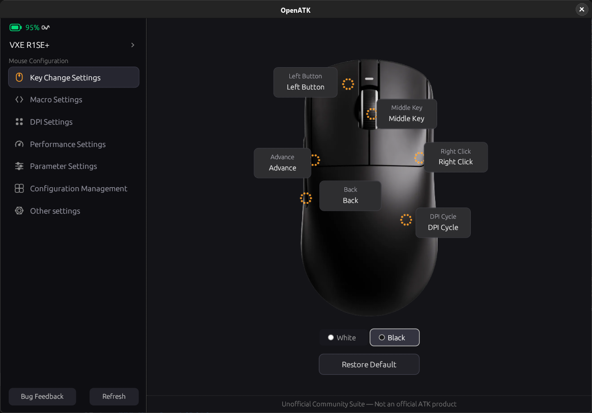
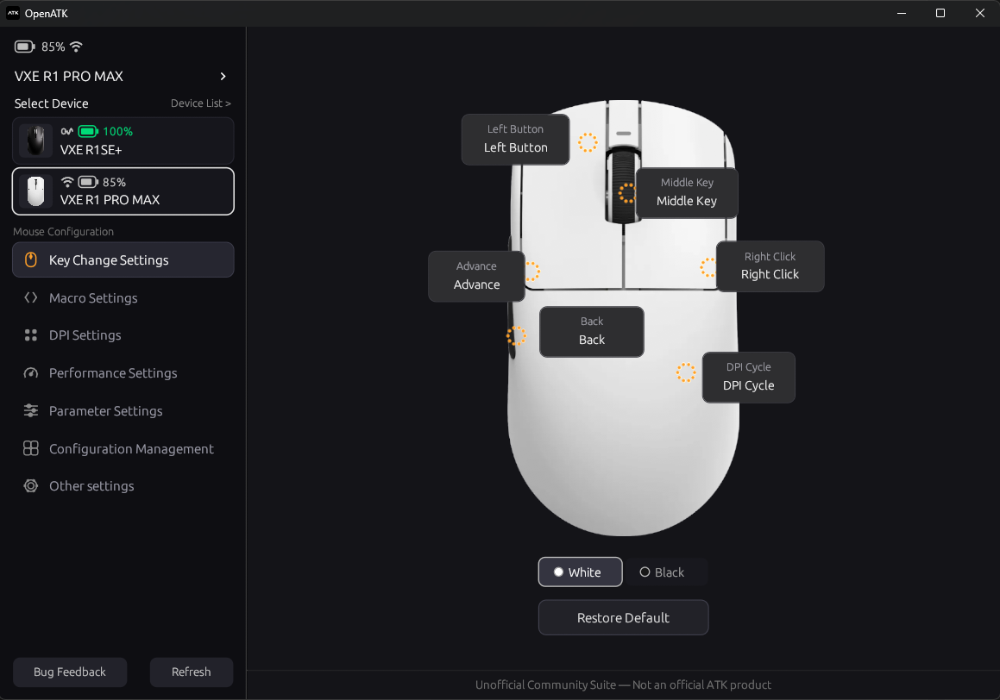
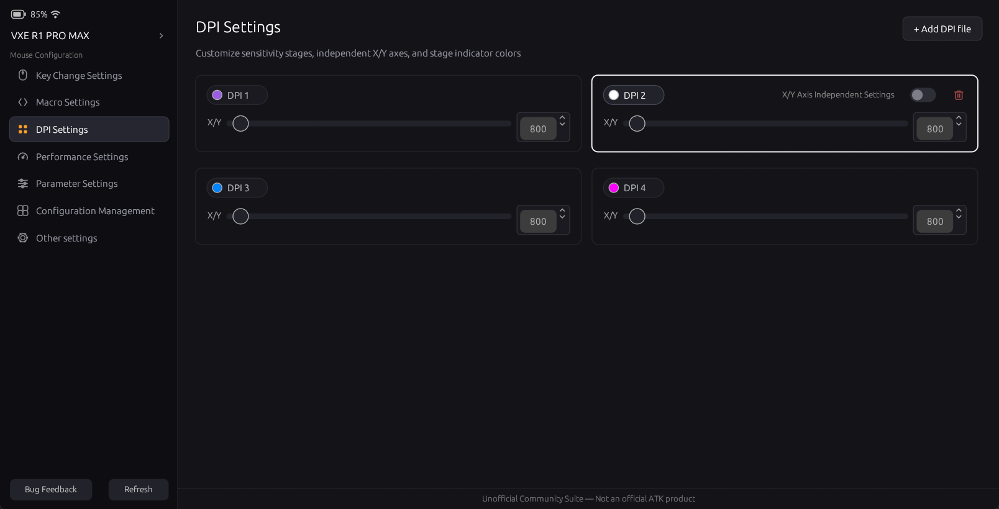
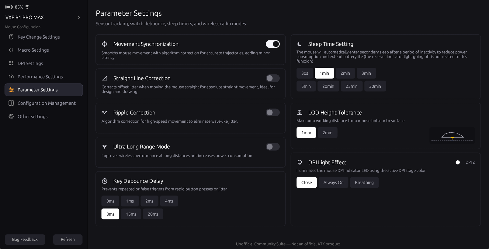
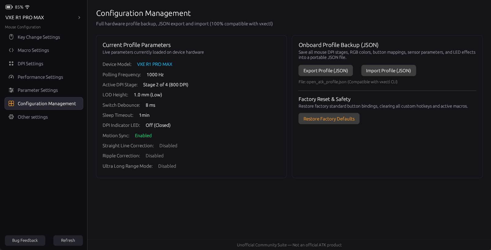
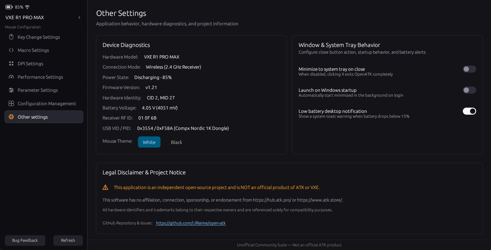

<div align="center">
  
  <h1>OpenATK &amp; vxectl</h1>
  <p><strong>Native, ultra-lightweight desktop suite &amp; CLI for ATK / VXE gaming mice</strong></p>

  <p>
    
    
    
    
  </p>

  <p>
    <a href="#graphical-desktop-suite-open-atk">Desktop GUI</a> •
    <a href="#vxectl">vxectl CLI</a> •
    <a href="#linux-support">Linux Setup</a> •
    <a href="#building-from-source">Build from Source</a> •
    <a href="#docs">Docs</a>
  </p>
</div>

> [!IMPORTANT]
> **Disclaimer:** This project is an independent, community-driven open-source software suite and is **NOT an official product of ATK or VXE**. This project has **no affiliation, sponsorship, endorsement, or association whatsoever** with [https://hub.atk.pro/](https://hub.atk.pro/) or [https://www.atk.store/](https://www.atk.store/). All trademarks, product names, logos, and brands belong exclusively to their respective owners.

A cross-platform (Windows & Linux), lightweight, and performance configuration suite for **ATK** and **VXE** gaming mice (including VXE R1 Pro Max, Dragonfly F1, MAD R, and compatible Compx Nordic MCU models) written natively in Rust using userspace USB HID.

The desktop graphical interface provides a clean, native experience inspired by professional eSports peripheral hubs: dark graphite theme, intuitive navigation, accurate 1:1 hardware layout with amber radar hotspots, real-time button remapping, and a comprehensive macro editor with system-wide Windows input reproduction.

---

## Graphical Desktop Suite: `open-atk`

An ultra-fast, native Rust GUI powered by `egui` / `eframe`: instant startup (< 50 ms), tiny RAM footprint (~30 MB), zero electron/browser overhead, and 100% offline functionality.

<p align="center">
  
  
</p>
<p align="center">
  <em>OpenATK running natively on Linux (GNOME desktop integration, VXE R1SE+) and Windows (VXE R1 Pro Max).</em>
</p>

### Quick Start:
```bash
# Run GUI directly via Cargo (or specify `--bin open-atk`):
cargo run --release --bin open-atk
# (or simply `cargo run --release`, configured as the default workspace member)
```

Or launch the compiled executable:
- **Windows** (see [Windows Build Guide](#windows)):
  ```powershell
  .\target\release\open-atk.exe
  ```
- **Linux** (see [Linux Build Guide & Dependencies](#linux)):
  ```bash
  ./target/release/open-atk
  ```

> [!TIP]
> Prefer terminal scripts, hotkeys, or headless servers? Run the CLI with `cargo run --release -p vxectl` or explore the [**`vxectl` Command-Line Utility**](#vxectl) section below.

### Key Capabilities:
1. **Key Change Settings (1:1 Reference Layout)**:
   - High-definition render of the mouse chassis with dynamic white and black themes.
   - Pixel-accurate amber dotted radar hotspots on all functional switches.
   - Direct interactive callout badges: Left Button, Middle Key, Right Click, Advance, Back, and DPI Cycle.
   - Comprehensive remapping modal: assign native mouse actions, DPI controls, media & volume utilities, or **custom macros**.
   - One-click factory reset (**Restore Default**).
2. **Macro Settings & Automation**:
   - Record physical keyboard keys in real time (`● Record Physical Key`).
   - Add any custom key (`A-Z`, `0-9`, `F1-F12`, `Space`, `Enter`, `Tab`, `Shift`, `Ctrl`, `Alt`, etc.) with customizable down/up events.
   - Full mouse action insertion (Left, Right, Middle clicks) and millisecond delay timers.
   - **Trigger Modes**:
     - **Single Run (`Once`)**: Executes the macro sequence once per trigger.
     - **Hold to Repeat (`Hold`)**: Repeatedly loops the sequence as long as the mouse button is physically held down.
     - **Toggle Loop (`Toggle`)**: Click once to start the infinite loop in background; click again to cleanly stop.
   - **Import & Export**: Backup and share your macro library as portable `.json` files.
   - **System-wide background execution:** Built-in low-level Windows hook (`WH_MOUSE_LL` + `SendInput`) ensures bound macros trigger reliably in all games and applications without physical button lockups.
3. **DPI Settings**:
   - Customize 4 individual sensitivity stages (50 to 26,000 DPI with 50 DPI precision).
   - Quick competitive presets: 400, 800, 1200, 1600, 2400, 3200 DPI.
   - Single-click active stage switching.

<p align="center">
  
</p>

4. **Performance Settings**:
   - Receiver communication polling frequency (125 Hz, 250 Hz, 500 Hz, 1000 Hz).
5. **Parameter Settings (1:1 Native Recreation of ATK Web Hub)**:
   - **Movement Synchronization**: Toggle sensor Motion Sync to smooth mouse trajectories with SPI-USB sync.
   - **Straight Line Correction**: Angle snapping algorithm correction for straight line design and drawing.
   - **Ripple Correction**: High-speed sensor wave jitter elimination.
   - **Ultra Long Range Mode**: Enhanced wireless transceiver power for long distances and noisy RF environments.
   - **Key Debounce Delay**: Segmented pill selectors (`0ms`, `1ms`, `2ms`, `4ms`, `8ms`, `15ms`, `20ms`) to eliminate microswitch contact chatter.
   - **Sleep Time Setting**: Secondary sleep delay options (`30s`, `1min`, `2min`, `3min`, `5min`, `20min`, `25min`, `30min`) to optimize battery longevity.
   - **LOD Height Tolerance**: Lift-off Distance (`1mm`, `2mm`) paired with a live vector chassis hover gap illustration.
   - **DPI Light Effect**: Control onboard LED indicators with modes (`Close`, `Always On`, `Breathing`), brightness levels (`Min`, `Medium`, `Max`), and effect speed (`Slowest`, `Medium`, `Fastest`).

<p align="center">
  
</p>

6. **System Tray & Background Daemon**:
   - **Minimize to Tray**: Closing the window hides the application to the system notification area without interrupting active macros.
   - **Live Battery Tooltip**: Hovering over the tray icon displays current device model, charge level (%), and charging status.
   - **Windows / Linux Autostart**: Option to automatically start the background daemon on user logon (`--minimized`).
   - **Low Battery Alert**: Automatic desktop toast notifications when any connected mouse drops below 15% battery.
7. **Configuration Management**:
   - Full onboard mouse profile backup and restore via portable JSON files (100% compatible with `vxectl`).
   - Live hardware telemetry inspection, factory reset, and profile synchronization.

<p align="center">
  
</p>

8. **Other Settings & Diagnostics**:
   - Real-time hardware telemetry: live battery voltage in millivolts (mV), charge state, firmware version, wireless receiver RF ID, and USB VID/PID.
   - Independent window behavior preferences (minimize to tray on close, launch on startup, low battery alerts).

<p align="center">
  
</p>

---

<a id="vxectl"></a>
## ⚡ Command-Line Utility: `vxectl`

For headless servers, competitive gaming scripts, and terminal power users with multi-device support, styled Unicode cards, ANSI colors, and structured JSON automation:

### 1. List Connected Devices
```bash
vxectl list
```
Displays all connected mice (wired USB-C or 2.4 GHz wireless), their index numbers, connection modes, battery telemetry, and short aliases in styled Unicode cards:
```text
╭── [0] VXE R1SE+ (1 of 2) ───────────────────────── ● Wired USB-C ──╮
│                                                                    │
│  Hardware Identity   : CID 2, MID 32                               │
│  Firmware Version    : v3.15                                       │
│  Battery Telemetry   : [██████████] 100% (Charging)  (4.24 V)      │
│  Target Aliases      : r1se+, r1, r1sep, se+, sep                  │
│                                                                    │
╰────────────────────────────────────────────────────────────────────╯

╭── [1] VXE R1 Pro Max (2 of 2) ─────────────── ● 2.4 GHz Wireless ──╮
│                                                                    │
│  Hardware Identity   : CID 2, MID 27                               │
│  Firmware Version    : v1.21                                       │
│  Battery Telemetry   : [████████░░] 85% (Discharging)  (4.04 V)    │
│  Target Aliases      : r1, r1pm, r1-pm, pm, promax                 │
│                                                                    │
╰────────────────────────────────────────────────────────────────────╯
```

Or query machine-readable device listings in JSON format:
```bash
vxectl list --json
```

### 2. Multi-Device Targeting (`-d` / `--device`)
Target devices by index (`0, 1...`), model substring, or fast short abbreviations:

| Device Model | Short Aliases (`-d <ALIAS>`) | Additional Aliases | Example Command |
| :--- | :--- | :--- | :--- |
| **VXE R1 Pro Max** | `r1pm`, `pm` | `r1promax`, `r1-pm` | `vxectl -d r1pm battery` |
| **VXE R1 Pro** | `r1p`, `pro` | `r1pro`, `r1-p` | `vxectl -d r1p status` |
| **VXE R1 SE+** | `r1sep`, `sep`, `r1se+`, `se+` | `r1seplus`, `seplus` | `vxectl -d r1sep set-stage 2` |
| **VXE R1 SE** | `r1se`, `se` | `vxer1se` | `vxectl -d r1se status` |
| **VGN Dragonfly F1 Pro Max** | `f1pm` | `f1promax`, `f1-pm`, `dragonfly` | `vxectl -d f1pm battery` |
| **VGN Dragonfly F1 Pro** | `f1p` | `f1pro`, `f1-p`, `dragonfly` | `vxectl -d f1p status` |
| **VGN Dragonfly F1 MOBA** | `f1m`, `moba` | `f1moba` | `vxectl -d f1m status` |
| **ATK Mad R** | `madr`, `mad` | `mad-r`, `atkmadr` | `vxectl -d madr set-polling 1000` |
| **ATK Mad R Major** | `madrm`, `major` | `madrmajor`, `madr-m` | `vxectl -d madrm status` |
| **ATK Mad R+ / Major+** | `madrp`, `madr+` | `madrplus` | `vxectl -d madrp battery` |
| **ATK X1 Pro Max** | `x1pm` | `x1promax`, `atkx1promax` | `vxectl -d x1pm status` |
| **ATK X1 Pro** | `x1p` | `x1pro`, `atkx1pro` | `vxectl -d x1p status` |
| **ATK X1 Ultra** | `x1u` | `x1ultra`, `atkx1ultra` | `vxectl -d x1u battery` |
| *(Any Device by Index)* | `0`, `1`, `2`... | Slot order in `vxectl list` | `vxectl -d 0 battery` |

```bash
# Query status using short alias:
vxectl -d r1pm battery
vxectl -d r1p status
vxectl -d r1sep set-stage 2
vxectl -d f1pm battery
vxectl -d madr set-polling 1000

# Target by index:
vxectl -d 0 status
vxectl -d 1 battery
```

### 3. Comprehensive Device Status
```bash
vxectl status
# Or default shorthand:
vxectl
```
Inspects all connected mice simultaneously with full sensor configuration, active stage markers (`★`), and ANSI color highlights:
```text
╭── [0] VXE R1SE+ (1 of 2) ───────────────────────── ● Wired USB-C ──╮
│                                                                    │
│  Hardware Identity   : CID 2, MID 32                               │
│  USB VID / PID       : 0x3554 / 0xF58F (VXE R1SE+ Wired)           │
│  Firmware Version    : v3.15                                       │
│  Battery Telemetry   : [██████████] 100% (Charging)  (4.25 V)      │
│  Target Aliases      : r1se+, r1, r1sep, se+, sep                  │
│                                                                    │
├─ Performance & Sensor ─────────────────────────────────────────────┤
│  Polling Frequency   : 1000 Hz  (1.0 ms interval)                  │
│  Active DPI Stage    : Stage 2 of 4                                │
│  DPI Stage Table     : [● 800]  [● 800 ★]  [● 800]  [● 950]        │
│  Lift-off Distance   : 1.0 mm (Low / Standard)                     │
│                                                                    │
├─ Advanced Switch & Radio Tuning ───────────────────────────────────┤
│  Debounce Delay      : 8 ms                                        │
│  Movement Sync       : Enabled                                     │
│  Straight Line       : Disabled                                    │
│  Ripple Control      : Disabled                                    │
│  Ultra Long Range    : Disabled                                    │
│  Sleep Timeout       : 1 min                                       │
│  DPI Indicator LED   : Off (Closed)                                │
│                                                                    │
╰───────────────────────────────────────────────── vxectl v0.1.0 ────╯

╭── [1] VXE R1 Pro Max (2 of 2) ─────────────── ● 2.4 GHz Wireless ──╮
│                                                                    │
│  Hardware Identity   : CID 2, MID 27                               │
│  USB VID / PID       : 0x3554 / 0xF58A (Compx Nordic 1K)           │
│  Receiver RF ID      : 01 0F 6B                                    │
│  Firmware Version    : v1.21                                       │
│  Battery Telemetry   : [████████░░] 85% (Discharging)  (4.05 V)    │
│  Target Aliases      : r1, r1pm, r1-pm, pm, promax                 │
│                                                                    │
├─ Performance & Sensor ─────────────────────────────────────────────┤
│  Polling Frequency   : 1000 Hz  (1.0 ms interval)                  │
│  Active DPI Stage    : Stage 3 of 4                                │
│  DPI Stage Table     : [● 800]  [● 800]  [● 800 ★]  [● 800]        │
│  Lift-off Distance   : 1.0 mm (Low / Standard)                     │
│                                                                    │
├─ Advanced Switch & Radio Tuning ───────────────────────────────────┤
│  Debounce Delay      : 8 ms                                        │
│  Movement Sync       : Enabled                                     │
│  Straight Line       : Disabled                                    │
│  Ripple Control      : Disabled                                    │
│  Ultra Long Range    : Disabled                                    │
│  Sleep Timeout       : 1 min                                       │
│  DPI Indicator LED   : Off (Closed)                                │
│                                                                    │
╰───────────────────────────────────────────────── vxectl v0.1.0 ────╯
```

If a wireless mouse is in power-saving sleep mode, `vxectl` detects receiver presence and outputs a standby card:
```text
╭── [1] VXE R1 Pro Max (2 of 2) ───────── ⏾ Standby (Mouse Asleep) ──╮
│                                                                    │
│  Hardware Identity   : CID 2, MID 27                               │
│  Receiver Status     : 2.4 GHz Dongle Online                       │
│  Receiver RF ID      : 0x47, 0x1F, 0x56, 0x3E                      │
│  Device Status       : Deep Sleep / Power Standby                  │
│                                                                    │
│  Note: Move or click the mouse to wake sensor telemetry.           │
│                                                                    │
╰───────────────────────────────────────────────── vxectl v0.1.0 ────╯
```

### 4. Structured JSON Telemetry & Automation (`--json`)
Export full device telemetry in structured JSON for automation scripts, Waybar / Polybar status bars, or Home Assistant integration:

```bash
# Full telemetry of all connected devices:
vxectl status --json

# Telemetry for a specific target device:
vxectl -d r1pm status --json
```

<details>
<summary><strong>View example JSON telemetry output</strong></summary>

```json
[
  {
    "index": 1,
    "model": "VXE R1 Pro Max",
    "connection_mode": "2.4 GHz Wireless",
    "firmware_version": "v1.21",
    "usb_vid": "0x3554",
    "usb_pid": "0xF58A",
    "usb_device": "0x3554 / 0xF58A (Compx Nordic 1K)",
    "receiver_rf_id": "01 0F 6B",
    "is_sleeping": false,
    "hardware_identity": {
      "cid": 2,
      "mid": 27
    },
    "battery": {
      "percentage": 85,
      "charging": false,
      "voltage_mv": 4051,
      "voltage_v": 4.051
    },
    "aliases": ["r1", "r1pm", "r1-pm", "pm", "promax"],
    "polling_rate_hz": 1000,
    "active_stage": 3,
    "stage_count": 4,
    "dpi_stages": [
      { "stage": 1, "dpi_x": 800, "dpi_y": 800, "rgb": "#9B5DE5", "active": false },
      { "stage": 2, "dpi_x": 800, "dpi_y": 800, "rgb": "#FFFFFF", "active": false },
      { "stage": 3, "dpi_x": 800, "dpi_y": 800, "rgb": "#0084FF", "active": true },
      { "stage": 4, "dpi_x": 800, "dpi_y": 800, "rgb": "#FF00FF", "active": false }
    ],
    "tuning": {
      "lod_mm": 1.0,
      "debounce_ms": 8,
      "motion_sync": true,
      "straight_line": false,
      "ripple_control": false,
      "ultra_long_range": false,
      "dpi_light_effect": "Off (Closed)",
      "sleep_timeout_sec": 60
    }
  }
]
```

</details>

### 5. Battery Telemetry
```bash
vxectl battery
# 85% (Discharging, 4.05 V)

vxectl battery --json
# {"model": "VXE R1 Pro Max", "percentage": 85, "charging": false, "voltage_mv": 4051}
```

### 6. Switch DPI Stage
```bash
# Query active stage:
vxectl set-stage

# Activate Stage 2:
vxectl set-stage 2
```

### 7. Configure Stage DPI
```bash
# Set 1600 DPI on Stage 2:
vxectl set-dpi 2 1600

# Set independent X and Y axis DPI:
vxectl set-dpi 2 1600 --y 1200
```

### 8. Polling Rate
```bash
# Query current polling frequency:
vxectl set-polling

# Set 1000 Hz:
vxectl set-polling 1000
```

### 9. Sensor & Switch Advanced Tuning
```bash
# Query or set Lift-off Distance (1 = 1.0mm, 2 = 2.0mm):
vxectl set-lod
vxectl set-lod 1

# Query or set Debounce Delay (0 to 20 ms):
vxectl set-debounce
vxectl set-debounce 4

# Toggle or set Motion Sync (on / off / true / false):
vxectl set-motionsync
vxectl set-motionsync on

# Toggle Straight Line correction:
vxectl set-straightline on

# Toggle Ripple Control:
vxectl set-ripple on

# Set Sleep Timeout (30s, 1m, 2m, 3m, 5m, 20m, 25m, 30m):
vxectl set-sleep 5m

# Set DPI Indicator LED (off, steady, breathing):
vxectl set-dpilight breathing

# Live terminal monitor (refreshes every 2s by default):
vxectl watch
vxectl watch --interval 5
```

### 10. Profile Backup & Restore (`export` / `import`)
```bash
# Export active onboard configuration to a portable JSON file:
vxectl export my_mouse_backup.json

# Restore configuration to the mouse:
vxectl import my_mouse_backup.json
```

### 11. Disable ANSI Styling (`--no-color`)
For plain ASCII output or automated log capture without escape codes, pass `--no-color` or define the `NO_COLOR=1` standard environment variable:
```bash
vxectl --no-color status
```

### 12. Shell Autocompletions (`completions` / `setup`)

#### Automatic 1-Click Setup:
You don't need to manually edit shell profiles. Run:
```bash
vxectl install-completions
# or simply:
vxectl setup
```
This automatically locates your shell profile (PowerShell `$PROFILE` on Windows, or `/usr/share/bash-completion` / `~/.bashrc` on Linux) and configures Tab autocompletions for you.

#### Manual Configuration (if preferred):
```bash
# PowerShell:
vxectl completions powershell | Out-String | Invoke-Expression

# Bash:
source <(vxectl completions bash)

# Zsh:
source <(vxectl completions zsh)

# Fish:
vxectl completions fish | source
```

---

<a id="linux-support"></a>
## 🐧 Linux Support & Installation

OpenATK and `vxectl` are fully functional under Linux with userspace USB HID (`libudev`).

### One-Command Installer:
From the project root on Linux:
```bash
sudo ./packaging/install.sh
```
This automatically:
- Installs `open-atk` and `vxectl` into `/usr/local/bin`
- Deploys the udev rules to `/etc/udev/rules.d/71-open-atk.rules`
- Reloads and triggers `udevadm`
- Installs the high-resolution desktop application icon and desktop launcher entry into system menus

### Or Quick udev Setup via CLI:
```bash
sudo vxectl install-udev
```

---

## Building from Source

### Prerequisites:
- Rust 1.80+ (`rustup default stable`)
- On Windows: MinGW (`x86_64-pc-windows-gnu`) or MSVC (`x86_64-pc-windows-msvc`)
- On Linux: `libudev-dev` and `pkg-config`

### Windows:
```powershell
cargo build --release --workspace
```
Binaries will be placed in `target/release/open-atk.exe` and `target/release/vxectl.exe`.

To install to your user `PATH` and create a Start Menu shortcut automatically:
```powershell
.\packaging\install.ps1
```

### Linux:
```bash
# Install core build & USB HID libraries
sudo apt update && sudo apt install -y build-essential pkg-config libudev-dev

# Install GUI window dependencies (for egui / eframe desktop window)
sudo apt install -y libxkbcommon-dev libx11-dev libwayland-dev libxcursor-dev libxrandr-dev libxi-dev libgl1-mesa-dev

# Build entire workspace
cargo build --release
```
Binaries will be placed in `target/release/open-atk` and `target/release/vxectl`.

---

<a id="docs"></a>
## 📚 Technical Documentation

Deep-dive engineering references for contributors and hardware researchers:

- **[System Architecture](docs/architecture.md)** — Workspace crate breakdown, non-blocking worker threads, and platform integration.
- **[HID Wire Protocol Specification](docs/protocol.md)** — 17-byte Compx report framing, opcodes, Modulo-256 checksums, and EEPROM register layouts.
- **[Device Notes & Registers](docs/device-notes.md)** — Supported Vendor/Product IDs, hardware model identifiers (CID/MID), and sensor capabilities.

---

## License & Trademarks

Licensed under the [GNU General Public License v3.0](LICENSE) (GPL-3.0-or-later).

All trademarks, product names, logos, and brands (including "ATK", "VXE", "Dragonfly", "R1 Pro Max", and "MAD R") are property of their respective owners. Their mention in this repository is solely for hardware compatibility and interoperability purposes under fair use.
